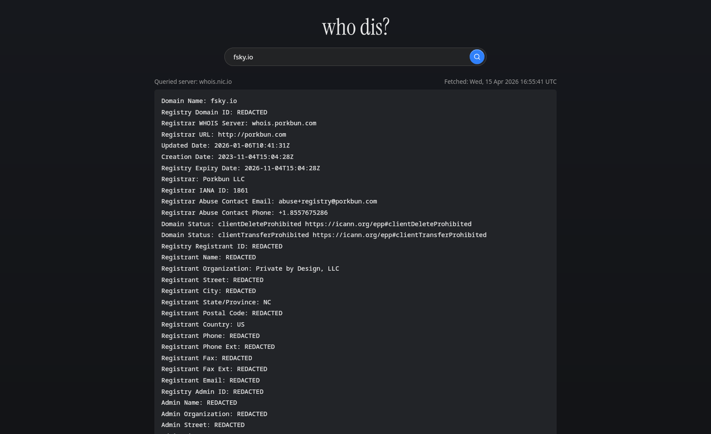

# who dis?

A lightweight, self-hosted RDAP and WHOIS lookup tool with a clean web
interface and an MCP server. Query domain names, TLDs, IP addresses, CIDR
ranges, ASNs, and tagged entity handles from your browser or your AI assistant.

The default Auto mode tries RDAP first and falls back to WHOIS when RDAP is
unavailable. RDAP responses are rendered as complete, syntax-highlighted JSON
on the server, with the exact upstream body available in a collapsed raw view;
the application does not require browser JavaScript.



## Deploying

### Container (recommended)

```sh
docker run -p 8080:8080 gitfield.org/fsky/whodis:latest
```

A [Quadlet](https://docs.podman.io/en/latest/markdown/podman-systemd.unit.5.html) unit file is available at [`contrib/quadlet/whodis.container`](contrib/quadlet/whodis.container) for deploying with Podman and systemd.

### From source

Requires Go 1.26+.

```sh
go build ./cmd/whodis
./whodis
```

Then open http://localhost:8080 in your browser.

## MCP server

whodis serves a [Model Context Protocol](https://modelcontextprotocol.io/)
endpoint at `/mcp` on the same port as the web UI, so assistants such as
claude.ai, ChatGPT, and Claude Code can run lookups without network access in
their own sandbox. It uses stateless Streamable HTTP and needs a public HTTPS
URL for hosted assistants; terminate TLS at your reverse proxy.

The server provides one read-only tool, `lookup`, with the same Auto, RDAP, and
WHOIS modes as the web UI. Results are compact JSON with one entry per queried
server and a `status` of `ok`, `not_found` (an authoritative RDAP 404),
`partial` (a later referral failed after an earlier server answered), or
`failed`. To keep the assistant's context small, RDAP documents omit their
`notices`, `links`, and `rdapConformance` members unless the tool is called
with `raw: true`, each body is capped at 32 KiB, and a body repeated by a later
referral is only included once. Both front ends share one cache.

### Access tokens

Set `MCP_TOKENS` to one or more comma-separated tokens of at least 32
characters, for example generated with `openssl rand -hex 32`. A client
presents a token either in an `Authorization: Bearer <token>` header or, for
assistants that can only be given a URL (claude.ai, ChatGPT), as a path
segment: `https://whodis.example/mcp/<token>`. Requests with a valid token are
never rate limited. With `MCP_REQUIRE_TOKEN=true`, requests without one are
rejected, making the endpoint private.

A token in the URL is recorded by anything that logs request paths, such as
your reverse proxy's access log. Rotate a leaked token by replacing it in
`MCP_TOKENS`.

Hosted assistants call the server from their provider's shared IP ranges, so
per-IP limits would make their users throttle each other. MCP rate limiting is
therefore off by default.

## Go packages

The protocol clients are importable without pulling the web application into
your program:

```go
import "gitfield.org/fsky/whodis/whois"

client := whois.NewClient()
result, err := client.Lookup(ctx, "example.com")
```

RDAP exposes the same raw-response style of API:

```go
import "gitfield.org/fsky/whodis/rdap"

client := rdap.NewClient()
result, err := client.Lookup(ctx, "example.com")
for _, response := range result.Responses {
    fmt.Printf("%s returned %d bytes\n", response.URL, len(response.Body))
}
response, err := client.Query(ctx, "https://rdap.example/rdap/domain/example.com")
```

The repository remains one Go module, so its downloaded source archive also
contains the web app, but importing `whois` or `rdap` neither compiles nor
initializes the application package.

`Lookup` chooses an appropriate server and follows recognized referrals.
`Query` sends an exact, single-line query to a caller-selected `whois.Endpoint`.
Responses are returned as raw bytes together with the endpoint, exact wire
query, and referral metadata; interpreting registry records is left to the
caller.

When a later referral fails, `Lookup` returns the completed responses together
with the error. Errors support `errors.Is` and `errors.As`, including typed
operation errors and registry web URLs for resources without WHOIS service.

Automatic lookups only contact public WHOIS/RWhois endpoints by default.
Direct queries permit caller-selected private endpoints, and both policies can
be replaced with client options.

RDAP `Lookup` discovers the service from the checked-in IANA bootstrap data,
tries advertised alternatives, follows safe redirects and top-level registrar
referrals, and validates successful responses as JSON. Like WHOIS, it retains
completed responses in traversal order when a later referral fails. `Query`
fetches an exact caller-selected HTTP(S) URL. It permits private endpoints by
default, while automatic lookups only contact public addresses and pin
validated DNS results when dialing.

Some ccTLD registries run RDAP services that are not listed in the IANA
bootstrap registry. A short hand-maintained list in `rdap/data.go` (currently
`.co`, `.de`, and `.io`) is consulted only when IANA has no service for a
domain, and a test fails once a refreshed snapshot makes an entry redundant.

Both routing snapshots are compiled into the packages. Normal builds and tests
perform no bootstrap downloads. Maintainers can refresh the checked-in data
from the public registries with:

```sh
make refresh-data
```

Use `make refresh-whois` or `make refresh-rdap` to refresh only one snapshot.

## Development

The root Makefile provides the common workflows:

```sh
make                 # build ./whodis (the default target)
make run             # run from source
make check           # formatting check, go vet, and tests; fully offline
make test-race       # run tests with the race detector
make fmt             # format Go source in place
make container       # build whodis:dev with Docker (overridable)
make help            # list every target
```

Variables can be overridden on the command line, for example
`make BINARY=whodis-dev build` or
`make CONTAINER_ENGINE=podman IMAGE=localhost/whodis:dev container`.

## Configuration

Configuration is handled through environment variables:

| Variable                    | Default | Description                                                                 |
| --------------------------- | ------- | --------------------------------------------------------------------------- |
| `PORT`                      | `8080`  | TCP port the HTTP server listens on                                         |
| `CACHE_TTL`                 | `24h`   | Cache duration for successful lookups. Accepts Go duration strings (`1h`, `30m`, etc.) |
| `RATE_LIMIT_PER_MINUTE`     | `20`    | Per-IP rate limit applied only to web UI cache misses. Set to `0` to disable. |
| `RATE_LIMIT_BURST`          | `10`    | Maximum burst of cache-miss lookups a single IP can make before throttling. |
| `TRUST_PROXY_HEADERS`       | `false` | When `true`, honor `X-Forwarded-For` / `X-Real-IP` for client IP and `X-Forwarded-Proto` for generated absolute URLs. Only enable when whodis is behind a trusted reverse proxy. |
| `ENABLE_WEB_UI`             | `true`  | Serve the web UI. Set to `false` for an MCP-only instance.                  |
| `ENABLE_MCP`                | `true`  | Serve the MCP endpoint at `/mcp`. Set to `false` for a web-only instance.   |
| `MCP_RATE_LIMIT_PER_MINUTE` | `0`     | Per-IP rate limit applied only to MCP cache misses without a valid token. `0` disables it. |
| `MCP_RATE_LIMIT_BURST`      | `20`    | Maximum burst of MCP cache-miss lookups a single IP can make before throttling. |
| `MCP_TOKENS`                | empty   | Comma-separated MCP access tokens (at least 32 characters of `A-Z a-z 0-9 - . _ ~`). Requests with a valid token are never rate limited. |
| `MCP_REQUIRE_TOKEN`         | `false` | When `true`, reject MCP requests without a valid token.                     |

whodis refuses to start when `ENABLE_WEB_UI`, `ENABLE_MCP`, or
`MCP_REQUIRE_TOKEN` is not a valid boolean, when both front ends are disabled,
when a token is malformed, or when tokens are required but none are set.

Error results are cached for 5 minutes regardless of `CACHE_TTL`. Rate limiting only applies to cache misses. Popular lookups served from cache are never throttled.

## License

The code of this project is released under the [Zero-Clause BSD License](https://opensource.org/license/0bsd/). See the `LICENSE` file for details.
